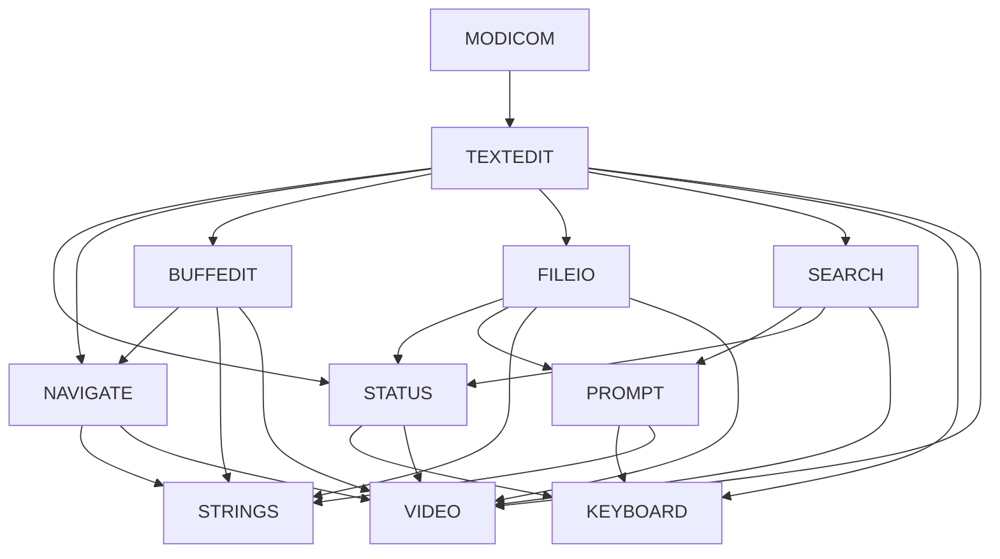

# ModiCom design (2.1)

This note describes the architecture of the DOS editor on `main`
(unreleased **2.1**). It is not a portability plan and does not
replace `BUILD.md` or `docs/history.md`.

## Purpose

ModiCom is a standalone text editor inspired by dBASE III+
`MODIFY COMMAND`. It targets Clipper / xBase source editing on
DOS without starting dBASE. The program opens a single named
file, edits it in a text-mode session, and exits back to the
shell.

## Runtime shape

- **Platform:** DOS text mode (colour mode 3 in the usual
  DOSBox setup).
- **Toolchain:** Borland C++ 3.1 and TASM; see `BUILD.md`.
- **Entry:** `MODICOM.C` requires exactly one argument (or
  `/?` for usage). It calls `textedit(filename)` and returns.
- **Session:** one edit buffer in memory, one status line,
  optional help strip, and a page of file text drawn by
  assembler video routines.

Compile-time `VERSION_M` (defined in `EDITOR.H` on this tree)
selects the `v2.1m` banner and omits a trailing Ctrl+Z on save.
Without it, the banner is `v2.1` and saves append Ctrl+Z.

## Modules

Shared constants and globals live in `EDITOR.H` /
`TEXTEDIT.C` (`start`, `ptr`, `end`, `fname`, cursor and
line state, `changed`, and related flags).

| Module | Role |
|--------|------|
| `MODICOM.C` | Argument check and usage banner |
| `TEXTEDIT.C` | Session loop (`textedit`), Ctrl+K commands (`ctrlkey`), abort confirm |
| `STATUS.C` | Help strip, status line, messages that wait for Space |
| `NAVIGATE.C` | Cursor, paging, word and line motion |
| `BUFFEDIT.C` | Insert, delete, newline, tab, and related buffer edits |
| `FILEIO.C` | Load, save, and in-session read/write file |
| `SEARCH.C` | Find prompt and search |
| `PROMPT.C` | Single-line status prompts |
| `KEYBOARD.C` | `getkey` / `getline` |
| `STRINGS.C` | Line length, EOL helpers, in-buffer replace |
| `VIDEO.ASM` | `showline` / `showpage` to colour text RAM |

## Dependencies

Edges below are “this translation unit uses that module”
(includes and calls), not a full call graph. System headers and
Borland libraries are omitted.

`TEXTEDIT` is the session hub. Navigate and Buffedit share
string and video helpers; File I/O and Search go through Prompt
for typed input and Status for the scoreboard / “press SPACE”
messages. Keyboard and Strings have no upward edges into the
editor modules.

## Buffer model

- Capacity is `MAXBYTES` (49152) bytes, allocated as
  `MAXBYTES + 1` so a trailing NUL always fits.
- Lines are stored as text, then carriage return (`\r`), then
  a NUL terminator. Soft carriage return `0x8d` (xBase) is
  treated as end-of-line by string and video helpers.
- On disk, newlines are LF (`\n`). Load converts LF → NUL for
  the in-memory form; save converts NUL → LF before writing.
- Names without an extension get `.prg` appended on load.
- Oversized files set `toobig` and may truncate; the status
  line warns that some data may be lost.

## Session control flow

1. Allocate the buffer and copy the file name.
2. Clear the screen, draw help, `loadfile`, paint status and
   the first page.
3. Loop: refresh line/column and modifier lamps, wait for a
   key, dispatch (navigate, edit, Ctrl+K, F1, Esc, save-quit).
4. On stop: clear the screen, free the buffer, return 0.

Esc runs an abort confirm when the buffer is dirty (`Y` aborts,
`N` continues; any key other than `n`/`N` also aborts). Ctrl+W
and Ctrl+End write if dirty, then quit, without a second
confirm. `changed` is not cleared after a successful write.

## Tests

Automated suites under `tests/` exercise modules in isolation
where practical (buffer ops, navigation, file I/O, prompts,
Status helpers, `ctrlkey`, and a short `textedit` session
path). Display for most suites is stubbed via `THARNESS`;
`TVIDEO` links the real assembler. See `tests/README.md`.
